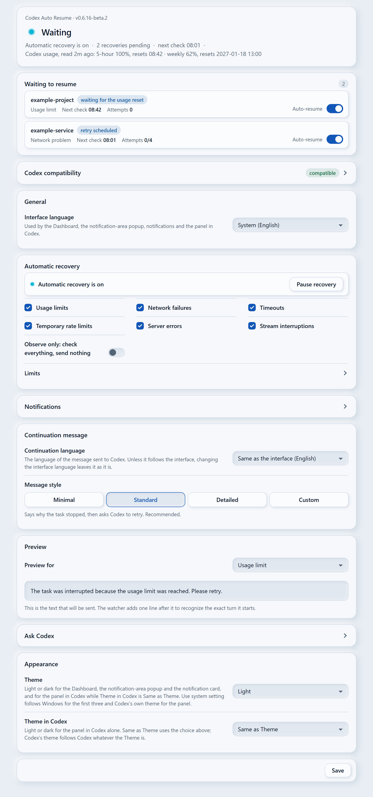
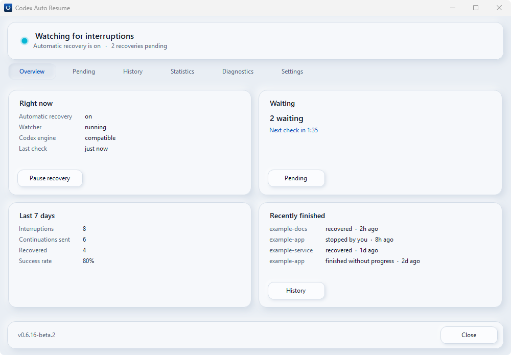
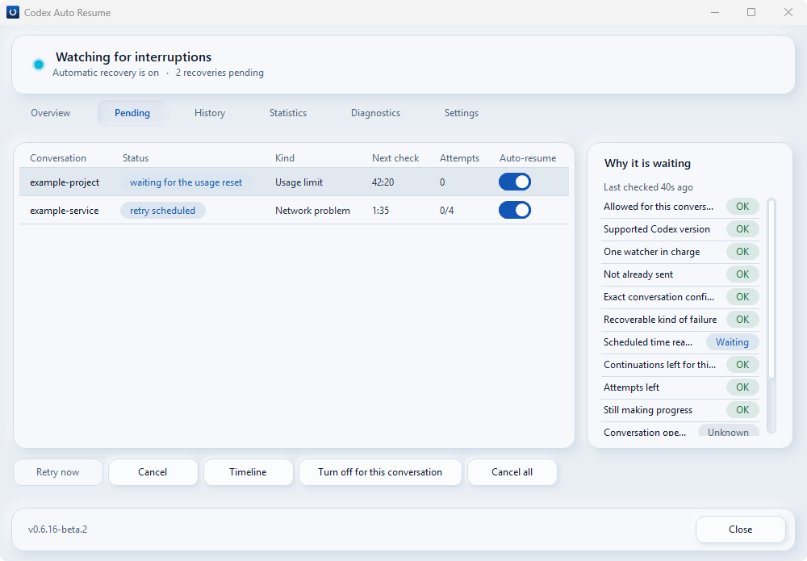
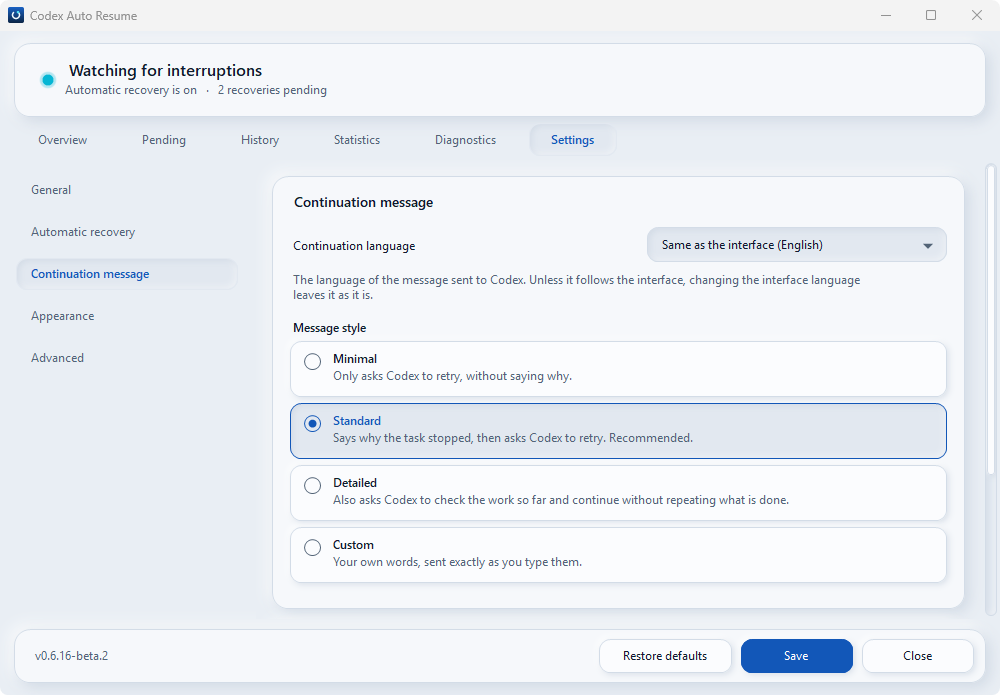

# Codex Auto Resume — форк TheEleage

> **Форк проекта [Codex Auto Resume](https://github.com/songyb111-gachon/codex-auto-resume-windows).**
> Оригинальная программа создана **[songyb111-gachon](https://github.com/songyb111-gachon)**.
> Я, **[TheEleage](https://github.com/TheEleage)**, поддерживаю собственную модификацию с Telegram-уведомлениями и улучшениями русского перевода.
> Авторство исходной программы остаётся за её первоначальным разработчиком.

Codex Auto Resume предназначен для Windows 10/11. Оригинальная программа отслеживает прерывания работы Codex Desktop из-за лимитов использования и некоторых временных сбоев и безопасно пытается возобновить **ту же беседу**, когда это допускают состояние приложения и его ограничения.

## Install

> **Установка оригинальной версии, не тестовой версии TheEleage.** Пока Telegram-функции
> находятся в Pull Request, установщики из основного репозитория автора не включают Telegram.
> Предварительные ZIP и EXE моего форка доступны только как артефакты успешной проверки
> [Windows Preview](https://github.com/TheEleage/codex-auto-resume-windows/actions/runs/38753298598);
> они предназначены для изучения и пока **не рекомендуются для замены рабочей установки**.
> Для ручного запуска исходных скриптов проекта необходим **Python 3.12** или новее;
> обычные установщики включают всё необходимое.

### From Codex (recommended)

Рекомендованная автором установка оригинального Codex Auto Resume через Codex:

```text
codex plugin marketplace add songyb111-gachon/codex-auto-resume-windows
codex plugin add codex-auto-resume@codex-auto-resume-windows
```

Затем попроси Codex настроить Auto Resume. Это **официальный исходный проект songyb111-gachon**,
не Telegram-форк TheEleage; настройки и рабочие задачи сохраняются при штатном обновлении.

### With the setup program

Официальный установщик исходного проекта можно получить в
[latest release](https://github.com/songyb111-gachon/codex-auto-resume-windows/releases/latest).
Установочные программы `CodexAutoResume-Setup-vX.Y.Z.exe` доступны **from v0.6.11 on**.
Проверь источник и контрольную сумму по
[инструкции автора](https://github.com/songyb111-gachon/codex-auto-resume-windows/blob/main/docs/VERIFY.md).
**Этот установщик пока не содержит мои Telegram-доработки.**

### Интерфейс исходного проекта

Изображения ниже показывают **оригинальную версию на английском языке**, а не новую
карточку «Telegram-бот». Они сохранены для ориентира и совместимости с документацией автора.











## Мои доработки (в рабочей ветке)

- **Telegram-бот:** отдельная карточка в настройках Windows Dashboard, с полями токена, Chat ID, переключателем и проверкой связи.
- **Дублирование уведомлений:** Telegram получает события через существующую систему уведомлений, а не путём чтения логов. Типы, отключённые в общих настройках, в Telegram не пересылаются.
- **Сведения о ходе работы:** сообщения о прерывании, ожидаемом времени восстановления лимита, начале продолжения, подтверждённом результате, ошибке и необходимости участия человека — когда соответствующее уведомление включено.
- **Защита токена:** отдельный файл настроек с шифрованием через Windows DPAPI для текущей учётной записи. Токен не возвращается интерфейсу после сохранения.
- **Русская локализация:** уточнены 17 формулировок интерфейса. Текущая языковая настройка пользователя сохраняется; русский можно выбрать через **Язык интерфейса**.
- **Тесты и документация:** добавлены проверки сохранения конфигурации, скрытия токена, отправки сообщений и обработки ошибок.

Подробная инструкция: **[Настройка Telegram](https://github.com/TheEleage/codex-auto-resume-windows/blob/feature/telegram-notifications/docs/TELEGRAM_RU.md)**.

## Статус разработки

**Ветка `main` содержит оригинальную основу программы и этот README. Telegram-интеграция и обновления перевода пока находятся в отдельной рабочей ветке; готовая сборка форка не выпущена.**

Изменения доступны в ветке [feature/telegram-notifications](https://github.com/TheEleage/codex-auto-resume-windows/tree/feature/telegram-notifications)
и обсуждаются в [Pull Request #1](https://github.com/TheEleage/codex-auto-resume-windows/pull/1).
До подтверждения тестов и сборки на Windows я не рекомендую заменять установленную рабочую версию.

Существующая логика автовозобновления сохранена. **Telegram пока только уведомляет**: команды управления Codex из чата не добавлены.
**Goal Continuation не изменён**: этот форк пока не решает вопрос многократного продолжения цели после отдельного завершённого хода Codex.

## Безопасность и конфиденциальность

Telegram **отключён по умолчанию**. При включении отправляются короткие служебные сведения и, если он известен, ID беседы. Текст задания, переписка, ответы модели, пути к проектам и токен бота в сообщения не включаются.
Нужно учитывать, что **сам факт активности и идентификатор беседы передаются внешнему сервису Telegram**; это отличается от поведения оригинальной программы без Telegram. Для уведомлений лучше использовать доверенный приватный чат.

Ошибки сети Telegram не должны блокировать основной процесс восстановления Codex. Отправка сообщения не означает, что работа Codex выполнена до конца: успешное возобновление и достижение цели — разные события.

## Техническая документация и передача данных

[Исходная политика конфиденциальности](docs/PRIVACY.md) ·
[Рекомендации по безопасности](docs/SECURITY.md) ·
[Настройка Telegram в моём форке](https://github.com/TheEleage/codex-auto-resume-windows/blob/feature/telegram-notifications/docs/TELEGRAM_RU.md)

| Параметр | Что происходит |
| --- | --- |
| **Privacy / telemetry** | No telemetry. При установке исходной версии происходит download релиза через GitHub. По явному запросу «Check for updates» читается список релизов на api.github.com; команда «Install another version...» тоже читает список версий GitHub. Telegram Bot API вызывается только после включения Telegram-уведомлений: отправляются тип события, Chat ID и при наличии UUID беседы, но не текст задачи. |

## Авторы и лицензия

- **Оригинальная программа:** [songyb111-gachon/codex-auto-resume-windows](https://github.com/songyb111-gachon/codex-auto-resume-windows) — автор **songyb111-gachon**.
- **Сопровождение и изменения этого форка:** [TheEleage/codex-auto-resume-windows](https://github.com/TheEleage/codex-auto-resume-windows) — **TheEleage**.
- **Лицензия:** [MIT](LICENSE). Авторское уведомление оригинального проекта сохранено без изменений.

**[Оригинальный README и инструкции автора (на английском)](https://github.com/songyb111-gachon/codex-auto-resume-windows#readme)**. Текущий README — описание моей модификации; исходная лицензия и авторские права сохранены.
